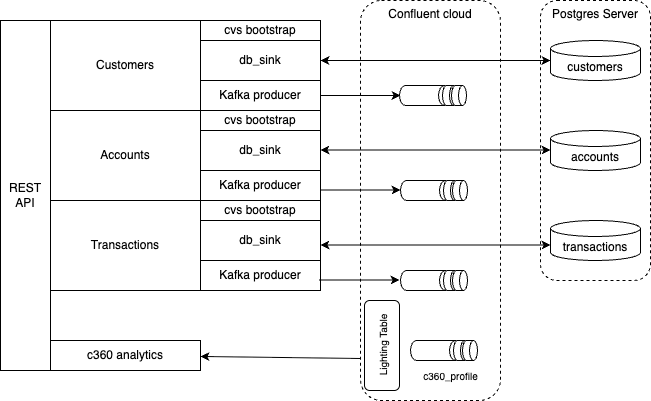

# A Fast API Backend to simulate different microservices

The goal of this component is to offer REST APIs on customers, accounts, transactions resources. The backend, based on FastAPI, implements the following architecture.



Each component is isolated in term of code base so it can be packaged, if needed as microservice. 
 
The structure is the same for all compoents:

* REST API resource 
* Support two write sinks controlled by a single `SINK` environment variable:

| `SINK` value | Write path | Read path |
|---|---|---|
| `postgres` *(default)* | INSERT / UPDATE RDS PostgreSQL | SELECT from PostgreSQL |
| `kafka` | Produce Avro message to Confluent topic | Read from in-memory CSV |

* CVS bootstrap for controlled data. When `SINK=postgres`, the backend auto-creates the schema on startup.  When `SINK=kafka`, the CSV remains the in-memory read store for all GET requests.
* Centralise all environment-driven settings in one place so every module imports from `config` rather than calling `os.environ` directly. The dotenv file path is read from the `ENV_CONFIG_FILE` environment variable (default `.env`); real environment variables always take precedence over its contents.
* When `SINK=kafka`, write operations produce Avro-serialised messages to the Confluent topic using the Confluent Schema Registry. This bypasses CDC and lets the demo run without an RDS instance.

* Define the canonical Pydantic schema for a Customer, matching the PostgreSQL table exactly (field names, types, optionality). This model is shared by all three layers: API request/response, database writes, and Kafka Avro payload.
* Inventory pattern to support in-memory data for demo
* Leverage a thin orchestration layer that dispatches CRU operations to the correct sink and always uses `inventory.py` for reads when `SINK=kafka`.
* Expose the Customers CRU endpoints as a FastAPI `APIRouter`. The router delegates all logic to `service.py` and handles HTTP status codes.
* Local postgres server for integration tests and demonstration
* The `main.py` wires the FastAPI app, includes routers, and runs startup lifecycle hooks (schema creation + CSV seeding for `SINK=postgres`; CSV caches load for `SINK=kafka`).
    ```sh
    uv run uvicorn main:app --reload
    ```

* TheFastAPI backend is under `apps/backend/`
* This is a `uv` managed project

## Customers CRUD operations

Exposes a **Customers CRU REST API**. The seed file (`customers/data/customers.csv`) ships with 10 pre-populated customers. 

**Expected Outcomes:**
- `POST /customers` → 201 Created, returns `Customer`
- `GET /customers` → 200, returns `list[Customer]`
- `GET /customers/{customer_id}` → 200 or 404
- `PUT /customers/{customer_id}` → 200 or 404

## Accounts CRU operations

Exposes an **Accounts CRUD REST API** mirroring customers, stored in Postgres.

**Expected Outcomes:**
- `POST /accounts` → 201 Created, returns `Account` (409 on duplicate `account_number`)
- `GET /accounts` → 200, returns `list[Account]`
- `GET /accounts/{account_id}` → 200 or 404
- `PUT /accounts/{account_id}` → 200 or 404
- `DELETE /accounts/{account_id}` → 204 or 404

When `KAFKA_PRODUCE_ENABLED` is on, create/update/delete also emit a best-effort Debezium envelope to `KAFKA_TOPIC_ACCOUNTS` (default `cdc.public.accounts`); failures are logged, never failing the DB op.

## Seeding Kafka at startup (`KAFKA_SEED_ON_START`)

When `KAFKA_SEED_ON_START=true` (default `false`), the lifespan loads the seed CSVs and publishes every record as a Debezium `create` event to `KAFKA_TOPIC_CUSTOMERS`, `KAFKA_TOPIC_ACCOUNTS` and `KAFKA_TOPIC_TRANSACTIONS` (in that order). It is best-effort (failures are logged, startup continues) and is ignored when `CDC_CONNECTOR_ENABLED` is true, since the connector then owns those topics. It runs on every start, so enable it only when you want the records re-published; ids are deterministic, so re-runs upsert the same keys.


## Kafka dual-write (`KAFKA_PRODUCE_ENABLED`)

The env setting `KAFKA_PRODUCE_ENABLED` (default `false`) controls whether writes also emit a Kafka event (dual-write) when Postgres is the sink. Changing it requires a restart.

When enabled, `create`/`update`/`delete` on the Postgres path emit a best-effort Kafka event (`c`/`u`/`d`); a produce failure is logged and never fails the DB operation. The `SINK=kafka` path is unaffected.

### CDC ownership guard (`CDC_CONNECTOR_ENABLED`)

`KAFKA_PRODUCE_ENABLED` is the right control for **local mode** (local Docker
Postgres, no connector): the app is the only producer, so turn it on to emit
Debezium-shaped events to `cdc.public.*`.

For **RDS / remote PostgreSQL**, a managed Debezium CDC connector reads the WAL
and publishes `cdc.public.*` itself. The app must therefore **never** also emit,
or every change is published twice. The env setting `CDC_CONNECTOR_ENABLED`
(default `false`) is a hard guard: when `true`, `_maybe_emit` returns before
`KAFKA_PRODUCE_ENABLED` is even consulted, so emission is off regardless of it.

| Deployment                         | `CDC_CONNECTOR_ENABLED` | App emits Kafka?                     |
| ---------------------------------- | ----------------------- | ----------------------------------- |
| Local Postgres, no connector       | `false` (default)       | Only if `KAFKA_PRODUCE_ENABLED=true` |
| RDS / remote PG + CDC connector    | `true`                  | Never (connector owns `cdc.public.*`) |

Set it per deployment: `scripts/set_env_from_tf.sh` exports `true` for the RDS
path, and `scripts/run_dev.sh --db rds` forces `true`. The `SINK=kafka` path is
unaffected (it has no Postgres and no connector).

## Testing

1. Start the container
```sh
cd apps/backend
./start_local_pg_server.sh
```

2. Point the backend at it
```sh
cp .env.local .env
```

3. Start the API (auto-creates schema + seeds 10 customers on first boot)
```sh
uv run uvicorn main:app --reload
```

4. Access the REST API at [http://localhost:8000/docs](http://localhost:8000/docs) for the Swagger UI or http://localhost:8000/api/v1/customers

### Integration tests

```sh
uv run pytest -v tests/
```