# Demonstration Script

Two approaches: 

1. Local database, writing directly to Kafka topics defined within Confluent Cloud Kafka Cluster
2. Run Database on AWS, with Kafka Connector defined to get data from the database to Kafka topics. This approach has cost for the services on AWS.

The web application is able to write to remote database or work with local database and remote Kafka.

## Run with a remote database server

The architecture of the demonstration at the high-level looks like:

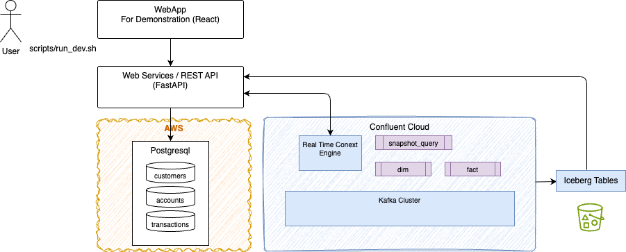

Once the Confluent Cloud and AWS resources are created by Terraform, the user starts the local web application that connect to remote database server.

* Set environment variables to access Confluent Cloud resources, like Kafka, schema Key/secret and bootstrap address:
    ```sh
    source ./scripts/set_env_from_tf.sh
    ```

    or use the .env file to create environment variables in your current terminal session:
    ```sh
    set -a
    source apps/backend/.env
    set +a
    ```
* Set environment variables to the .env file
    ```sh
    export ENV_CONFIG_FILE=./apps/backend/.env
    ```

* Start the local webapp with remote RDS database
    ```sh
    ./scripts/run_dev.sh --db rds
    ```

* [Follow with demonstration script](#demonstration-scenarios)

## Run with Local Database Get started locally

This time the database runs locally and the web app writes to kafka in parallel to write to database.

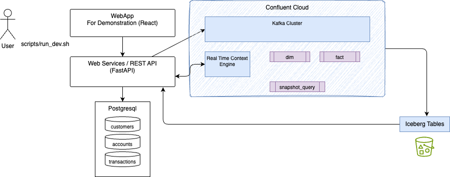


* Set environment variables to access Confluent Cloud resources, like Kafka, schema Key/secrets and bootstrap address. This can be done by looking terraform output:
    ```sh
    source ./scripts/set_env_from_tf.sh
    ```

    or using your own scripts to get environment variables preset, to an existing Confluent Cloud environment.

## Demonstration Scenarios

### Prepare backend environment

* Set where to find the specific `.env` file. You can use different .env file and reference it via environment variable:
    ```sh
    export ENV_CONFIG_FILE=$PWD/apps/backend/.env
    ```

* Start the local webapp
    ```sh
    ./scripts/run_dev.sh 
    ```


With the following settings, the backend service will create cdc topics, schemas, and send data to kafka directly:

```sh
SINK=postgres
KAFKA_PRODUCE_ENABLED=true
CDC_CONNECTOR_ENABLED=false
KAFKA_SEED_ON_START=true
```

When using remote database and pure CDC processing, using a CDC connector in Confluent cloud, the settings are:

```
CDC_CONNECTOR_ENABLED=true
KAFKA_SEED_ON_START=false
KAFKA_PRODUCE_ENABLED=false
```

### Deploy the Flink Statements / Materialized Tables

* Deploy the Flink statement using dbt
    ```sh
    cd pipelines
    source .venv/bin/activate
    # verify the version, if need to update, change in pyproject.yaml in pipelines folder
    dbt version
    # Deploy the c360 data product from the fact table to the parents
    dbt run --select +c360.facts.fct_c360_profile
    ```

* Once all materialized tables are deployed, we need to enable RTCE on the fact table. There is a separate terraform to do so.
    ```sh
    cd IaC/rtce
    terraform apply
    ```

    Should output:
    ```sh
    Apply complete! Resources: 5 added, 0 changed, 0 destroyed.

    Outputs:

    rtce_lightning_api_key_id = "IOGMHHDUI22T7GPE"
    rtce_lightning_api_key_secret = <sensitive>
    rtce_lightning_sa_id = "sa-r2z9987"
    rtce_topic_name = "fct_c360_profile"
    ```

    Verify in the console that the `fct_c360_profile` topic is enabled:
    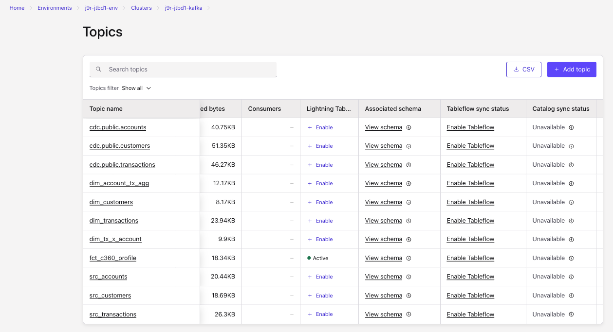

* Update environment variables to be able to get the Global key and secret
    ```sh
    CONFLUENT_GLOBAL_KEY=$(terraform output -raw rtce_lightning_api_key_id)
    CONFLUENT_GLOBAL_SECRET=$(terraform output -raw rtce_lightning_api_key_secret)
    ```

    or to also modify the backend .env file rerun:
    ```sh
    ./scripts/set_env_from_tf.s
    ```


### Use the Web App

[http://localhost:5173/](http://localhost:5173/)

#### Customers Management

The customers page presents a list of existing customers loaded from the database:

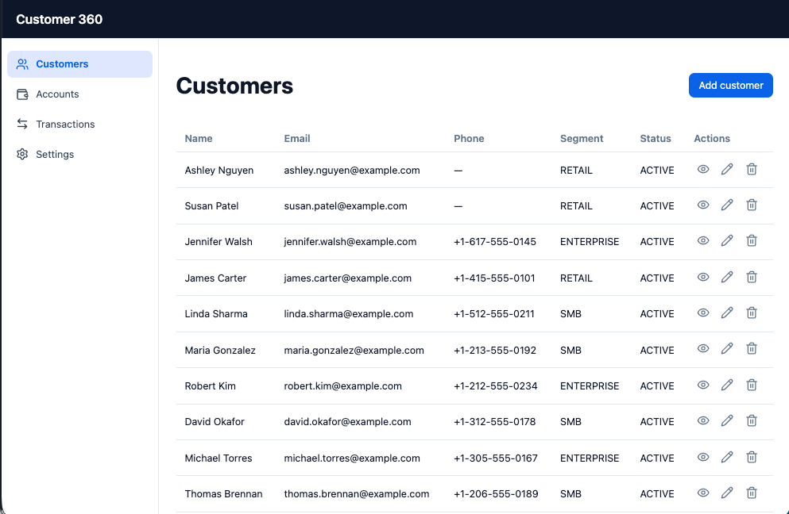

It is possible to add a new customer, with the Add customer button, or view, update, delete an existing customer using the action icon.

For example selecting the eye icon on James Carter brings this view:

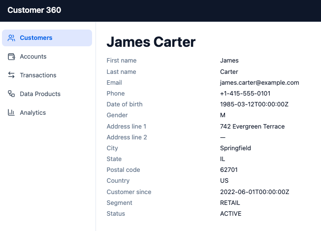

#### Accounts Management

The accounts page presents a list of account per customer loaded from the database:

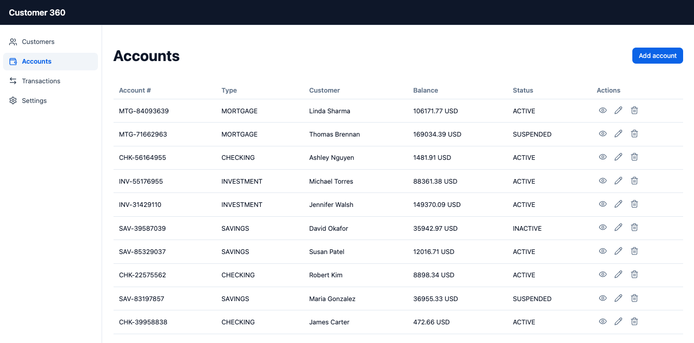


#### Transaction Management

The transactions page presents a list of current transactions in the database:

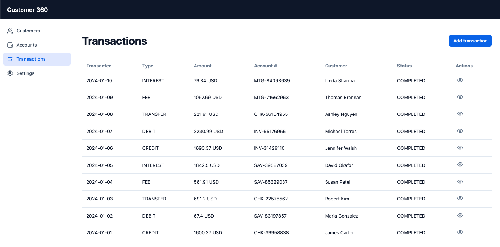

To simulate a week of activity, click **Generate 200 transactions**. The backend creates 200 transactions on existing accounts, timestamped from 7 days ago in 15-minute increments, inserts them in Postgres and (when `KAFKA_PRODUCE_ENABLED=true` and no CDC connector owns Kafka) publishes them to the `cdc.public.transactions` topic. The page then shows the newly created transactions (the list is not kept after a browser refresh).

### Data products view

This page demonstrates the presentation of metrics per data analytics as a product. 

* First select the analytics product
    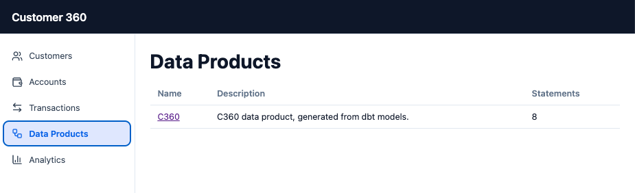

* See the pipeline graph for one of the fact table:
    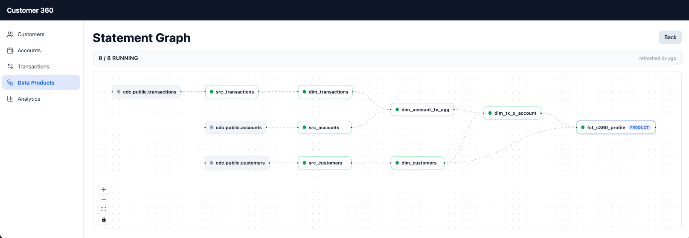

* User can drill down to see real-time metrics for on of the statement, and the deployed SQL query:
    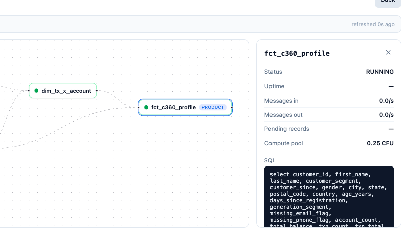

    The message in and out should be greater than 0 when there is record flowing into the topics.

### Analytics Dashboard

The Analytics page is an illustration of what can be done by directly accessing data in kafka

1. Get the aggregation cross customers, by querying, via Flink snapshot query, the `fct_c360_profile` topic
    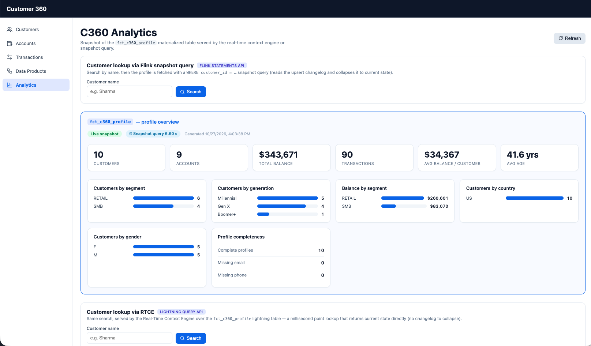

    The backend also returns the elapse time from a client point of view. Arrounf 6.60s to get results, using Flink Snapshot query.

1. Use the snapshot query, which creates a Flink Statement, to get a data for a user:
    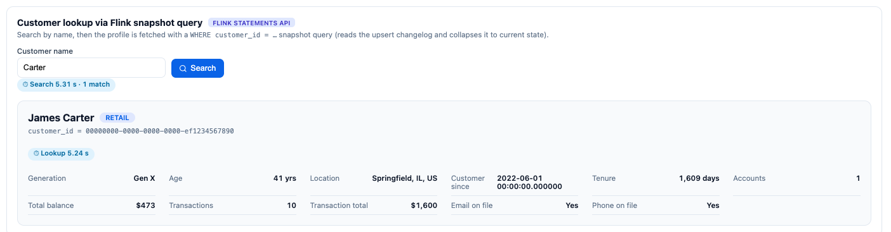
    Same as above the query now has where condition on the customer name.

1. We can do the same query with the new Real-time context engine, lightning query:
    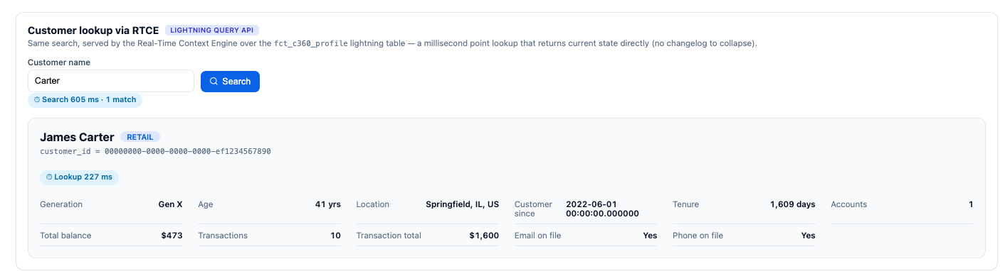

    We can see that it gets results in 605ms.

### Demonstrate Real-time Context Engine

There is a local LLM running in the background listening on http://localhost:7999/v1, so a OpenAPI compatible protocol. The backend is running an Agent with MCP tool defined in code, and the user interface support chatting with the customer 360 profile topic:

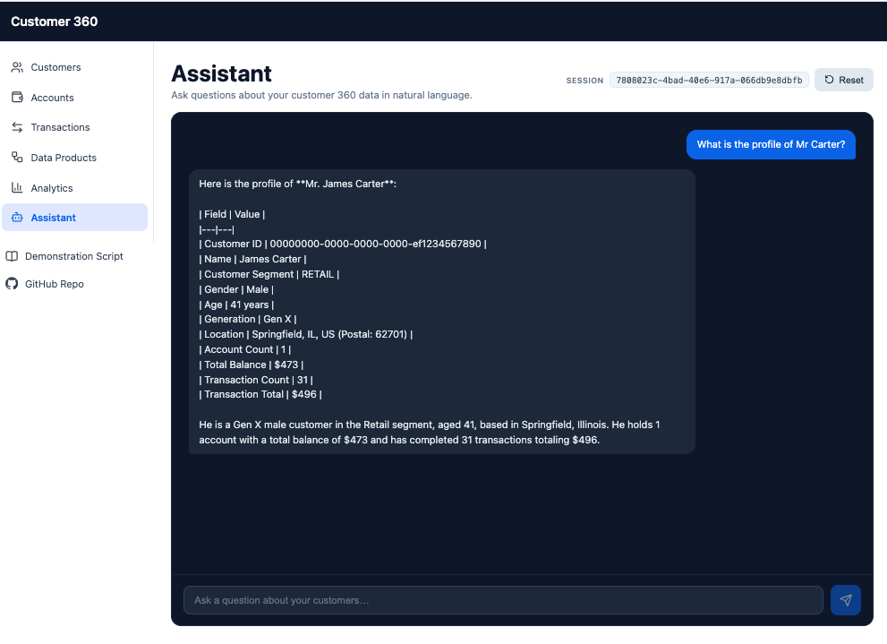

* Examples of query to ask:
    - What is the profile of Mr Carter?
    - what about Mrs Walsh profile?


### Verify data are in Postgresql tables. 

* Start a session in psql:
    ```sh
    container exec -it c360-postgres psql -U dbadmin -d c360db
    ```

    ```sql
    -- Row counts for all three tables
    SELECT 'customers'   AS tbl, COUNT(*) FROM customers
    UNION ALL
    SELECT 'accounts'    AS tbl, COUNT(*) FROM accounts
    UNION ALL
    SELECT 'transactions'AS tbl, COUNT(*) FROM transactions;

    -- Sample a customer with their accounts
    SELECT c.first_name, c.last_name, c.email, c.segment,
        a.account_type, a.balance
    FROM   customers c
    JOIN   accounts a USING (customer_id)
    LIMIT  10;

    -- Recent transactions
    SELECT t.transaction_type, t.amount, t.merchant_name,
        t.merchant_category, t.channel, t.status,
        t.transacted_at
    FROM   transactions t
    ORDER  BY t.transacted_at DESC
    LIMIT  10;

    -- Quit
    \q
    ```
