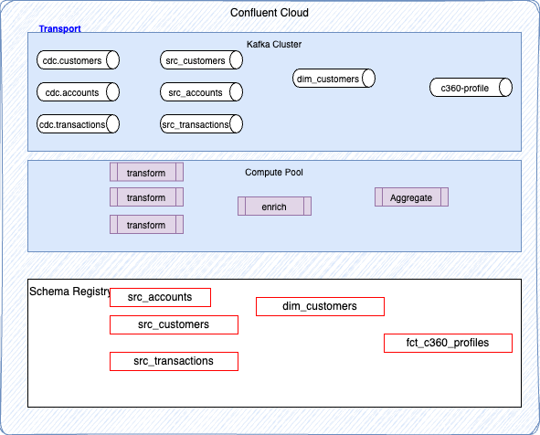
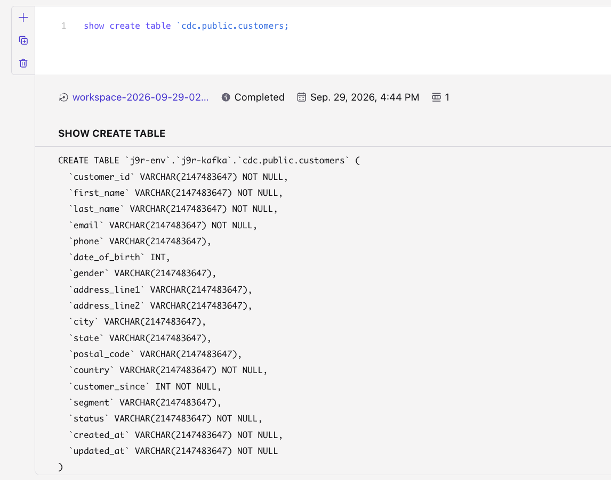
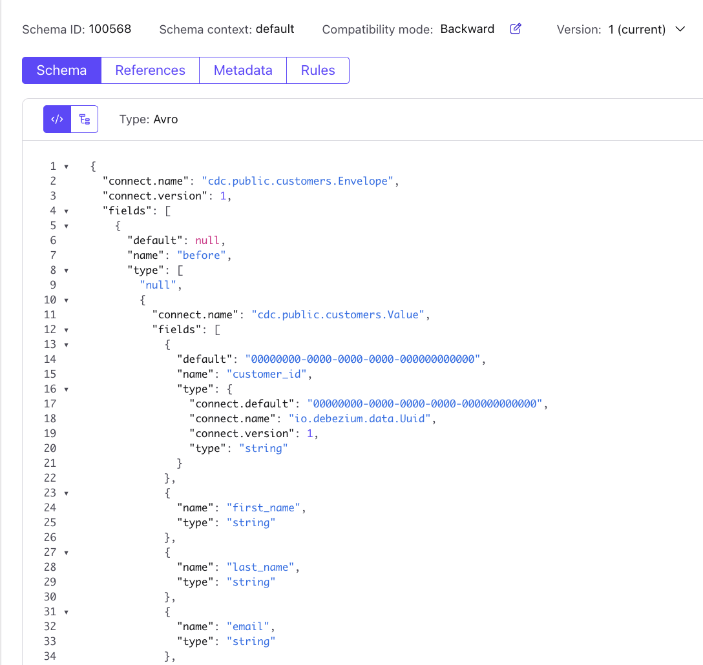
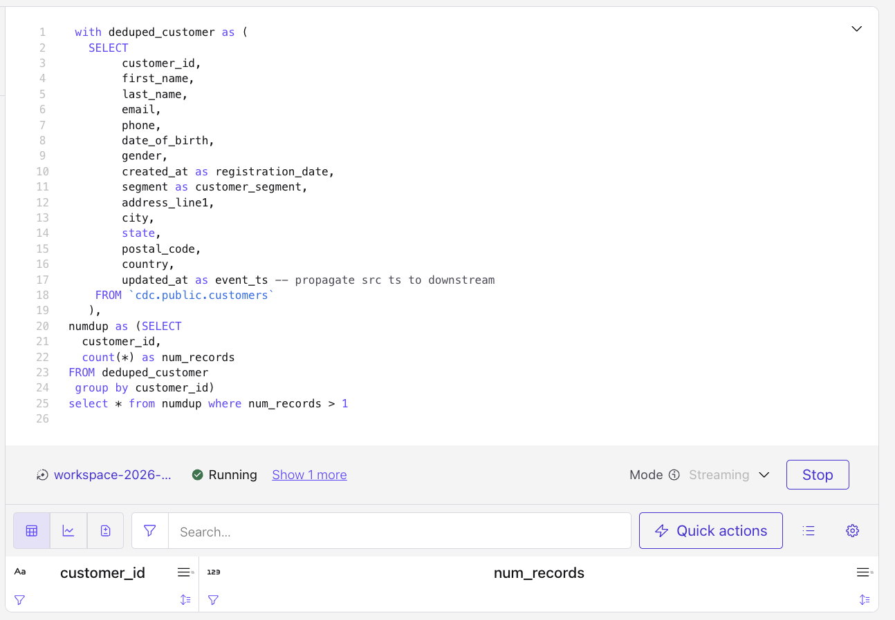

# Flink Project Management
This section addresses the Flink pipeline definition and management using [Confluent dbt](https://pypi.org/project/dbt-confluent/) plugin.

## What is built

We want to implement the following pipeline to process the raw/bronze layer of records coming out of the CDC Debezium source kafka connector (cdc.*):



To a silver layer which includes clean source data, with no duplicate, reflecting a canonical model and filtered records. The golden layer includes star schema dimensions and facts. For this demonstration the c360-profile defines analytics about a customer based on the buying transactions done so far.

The Confluent Cloud Flink statement organization reflects the medaillon and star schema structure.  The Flink statements run in a compute pool, already created via the terraform deployment (or reused but referenced in FLINK_COMPUTE_POOL_ID).

1. First, create the pipeline folder to manage the different Flink SQL statements, using the star schema pattern. This can be done manually or using a tool from [flink-tools-for-agents](https://github.com/jbcodeforce/flink-tools-for-agents/tree/main/tools/dbt) project, which complement the dbt Confluent CLI:
    ```sh
    git clone https://github.com/jbcodeforce/flink-tools-for-agents.git
    cd flink-tools-for-agents
    # run shift left for dbt project
    uv run sl-dbt init ~/Code/stream_house_c360_demo
    ```

    Here is the expected structure:
    ```sh
    stream_house_c360_demo
    ├── docs
    ├── IaC
    ├── local-tests
    ├── pipelines
    ├── sl_dbt.yaml
    └── tools
    ```

1. Add a data  analytic product named `c360`, to keep metrics for customer 360 view.
    ```sh
    uv run sl-dbt add-data-product ~/Code/stream_house_c360_demo c360
    ```

    Here is the expected structure:
    ```sh
    pipelines
        ├── dbt_project.yml
        ├── macros
        ├── models
        │   └── c360
        │       ├── dimensions
        │       ├── facts
        │       └── sources
        ├── pyproject.toml
        ├── seeds
        └── tests
    ```

1. Add one table as output of deduplicating customers raw data, and to filter unnecessary records:

    ```sh
     uv run sl-dbt add-table ~/Code/stream_house_c360_demo src_customers c360 --table-type  src
    ```

    ```sh
    pipelines
        ├── dbt_project.yml
        ├── macros
        ├── models
        │   └── c360
        │       ├── dimensions
        │       ├── facts
        │       ├── schema.yml
        │       └── sources
        │           ├── src_customers.sql
        │           └── src_customers.yml
        ├── pyproject.toml
        ├── seeds
        └── tests
    ```

1. Use the Confluent Cloud Workspace to develop query by using an incremental approach: starts by selecting the different sources, to assess data quality. We will illustrate the approach for beginner.

    1. Assess the source table structure. Run the SQL: `show create table cdc.public.customers`
        

        We can observe the Debezium envelop is already transformed to the sub schema. We can verify the schema definitiom in the schema registry has a before and after envelop. Go to schema registry page and select `cdc.public.customers-value`. The schema has Debezium fields of `before`, `after`, `op`...

        

        The reason is the default format for the value and the key are set as:
        ```sh
        value.format' = 'avro-debezium-registry'
        ```
        which means the Kafka Source connector inside Confluent Cloud Flink uses a specific [deserializer that processes the envelop model](https://docs.confluent.io/cloud/current/flink/reference/serialization.html#debezium-format).

        We can do the same for: `show create table cdc.public.accounts;` and `show create table cdc.public.transactions;`

        We can also discover that by default the changelog mode is set to `retract`. This is due to CDC debezium configuration that may not have  defined the primary key mapping. If the Kafka topic has `cleanup.policy` set to compact, the `changelog.mode` is set to upsert instead. 
        With `retract` we could not run snapshot queries but only streaming query. 

    1. Look at some data and select only active customers:
        ```sql
        SELECT * FROM `j9r-env`.`j9r-kafka`.`cdc.public.customers` where status = 'ACTIVE';
        ```

    1. Because the changelog mode is retract or upsert, within the topic there will be no duplicate for the current customers, accounts and transactions, the following query helps to validate that:
        ```sql
         with deduped_customer as (
            SELECT 
                    customer_id,
                FROM `cdc.public.customers`
            ),
            numdup as (SELECT
                customer_id,
                count(*) as num_records
            FROM deduped_customer
            group by customer_id)
            select * from numdup where num_records > 1
        ```

        

1. We can continue the data analysis and finally build the following Flink SQL to do some filtering and data cleaning. See [flink src processing folder](../flink_sqls/).

1. To be able to connect to Confluent Cloud, we need to set the environment variables for API keys and secrets. The following script loads those from Terraform output
    ```sh
    source ./scripts/set_env_from_tf.sh
    ```

    As an alternate source the .env file under apps/backend/

1. `dbt` needs models. The first layer is the references to existing CDC topics [see pipelines/models/sources.yaml](../pipelines/models/sources.yaml) file.

    ```yaml
    version: 2
    sources:
    - name: cdc
    schema: "{{ env_var('KAFKA_CLUSTER_NAME') }}"
    tables:
    - name: customers
        identifier: cdc.public.customers
    - name: accounts
        identifier: cdc.public.accounts
        description: accounts information for a customer    
    - name: transactions
        identifier: cdc.public.transactions
        description: Topic 'cdc.public.transactions' — registered via sl-dbt get-schema-existing-topic-to-dbt.
    ```

1. Be sure to modify your `.dbt/profiles.yml` with the following element.
    ```yaml
    cc_flink:
        outputs:
            dev:
                cloud_provider: '{{ env_var(''CC_PROVIDER'') }}'
                cloud_region: '{{ env_var('CC_REGION'') }}'
                compute_pool_id: '{{ env_var('FLINK_COMPUTE_POOL_ID'') }}'
                dbname: '{{ env_var('KAFKA_CLUSTER_NAME'') }}'
                environment_id: '{{ env_var('ENVIRONMENT_ID'') }}'
                execution_mode: streaming_query
                flink_api_key: '{{ env_var(''FLINK_API_KEY'') }}'
                flink_api_secret: '{{ env_var(''FLINK_API_SECRET'') }}'
                organization_id: '{{ env_var(''CC_ORG_ID'') }}'
                statement_label: dbt-confluent
                statement_name_prefix: dbt-
                threads: 4
                type: confluent
        target: dev
    ```

    This is a generic profile for Confluent Cloud  that uses environment variables to avoid sharing secrets in yaml file.

1. Continue to create the following flink statements to filter and transform raw CDC topics, create dimension and fact for the analytics.

The [path is pipelines/models/c360](../pipelines/models/c360)

| Source Table(s) | Folder Name | Sink Table | Goal |
| ----------------| ------------ |-----------|-----|
| cdc.public.accounts | sources | src_accounts | Deduplicate, flatten, filter, transform |
| cdc.public.customers | sources | src_customers | eduplicate, flatten, filter, transform |
| cdc.public.transactions| sources | src_transactions | eduplicate, flatten, filter, transform |
| src_customers | dimension |  dim_customers| Compute customer dimension |
| src_customers, src_account | dimension |  dim_customers| Compute transaction cross account metrics |
| dim_customers, | facts | fct_c360_profiles |

```sh
├── c360
│   ├── dimensions
│   │   ├── dim_account_tx_agg.sql
│   │   ├── dim_account_tx_agg.yml
│   │   ├── dim_customers.sql
│   │   ├── dim_customers.yml
│   │   ├── dim_transactions.sql
│   │   ├── dim_transactions.yml
│   │   ├── dim_tx_x_account.sql
│   │   └── dim_tx_x_account.yml
│   ├── facts
│   │   └── fct_c360_profile.sql
│   └── sources
│       ├── src_accounts.sql
│       ├── src_accounts.yml
│       ├── src_customers.sql
│       ├── src_customers.yml
│       ├── src_transactions.sql
│       └── src_transactions.yml
├── deploy_manifest.json
└── sources.yaml
```

Each model needs to have the table definition to create as sink. As an example the dimension to compute account aggregations look like ([file dim_account_tx_agg.sq](../pipelines/models/c360/dimensions/dim_account_tx_agg.sql)):

```yaml
models:
- name: dim_account_tx_agg
  description: "Aggregates cross account"
  config:
    contract:
      enforced: true
  columns:
  - name: account_id
    data_type: varchar(2147483647)
    constraints:
      - type: not_null
      - type: primary_key
        expression: "not enforced"
  - name: customer_id
    data_type: string
  - name: account_type
    data_type: string
  - name: account_status
    data_type: string
  - name: balance
    data_type: DECIMAL
  - name: txn_count
    data_type: DECIMAL
  - name: txn_total
    data_type: DECIMAL
  - name: last_transacted_at
    data_type: timestamp_ltz
```

## Deploy

dbt supports different way to manage the dependencies. We can use tag, folder, or tree.

* Deploy all the sources that are the first level of flink statements to deploy
```sh
# within the pipelines folder:
dbt run --select c360.sources --full-refresh
```
* Deploy the facts and its parents

```sh
# within the pipelines folder:

```

## Undeploy

1. As dbt does not support undeploying, we need another tool to manage the drop table and undeploy statement. The [flink-tools-for-agents](https://github.com/jbcodeforce/flink-tools-for-agents/tree/main/tools/flink) includes tools to define a manifest of metadata about existing statements and then perform deplooy, undeploy and drop tables. 
    ```sh
    cd flink-tools-for-agents 
    uv run generate-manifest --sql-dir ../stream_house_c360_demo/pipelines/models 
    # OR
    uv run generate-manifest --sql-dir ../stream_house_c360_demo/pipelines/models --overwrite 
    ```

    Drop tables listed in the `drop_tables` element of the manifest
    ```sh
    uv run flink-sql-deploy  --sql-dir ../stream_house_c360_demo/pipelines/models drop-tables 
    ```

### IaC

* Remove connector
    ```sh
    ./scripts/tf_connector.sh destroy
    ```

* Remove Confluent Cloud resources
    ```sh
    ./scripts/tf.sh destroy
    ```

* Remove AWS resources
    ```sh
    ./scripts/tf_aws.sh destroy
    ```