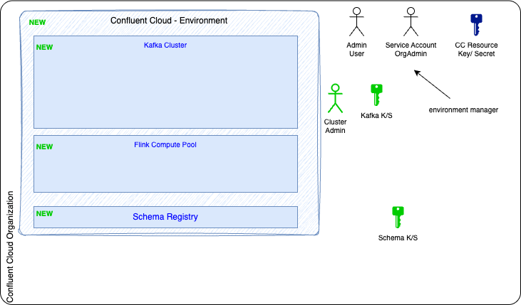
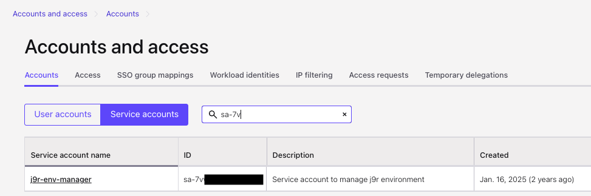
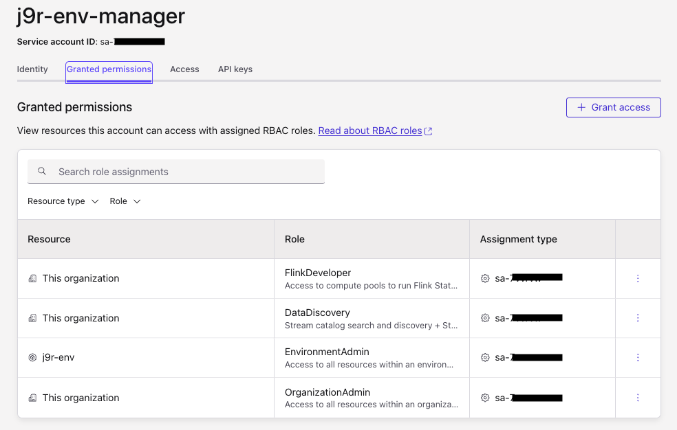
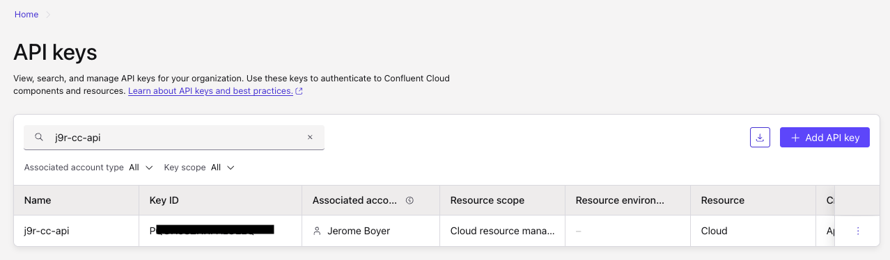
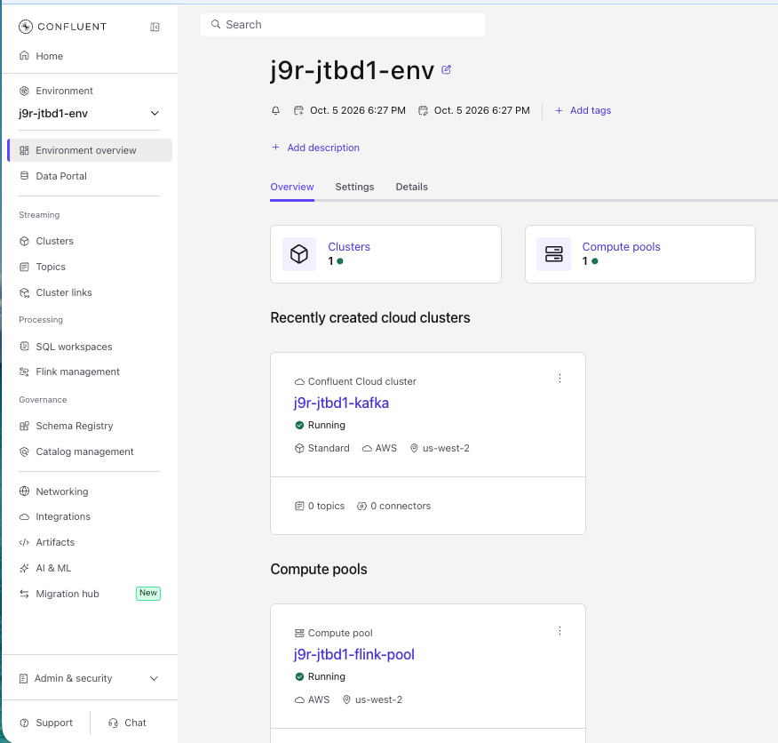
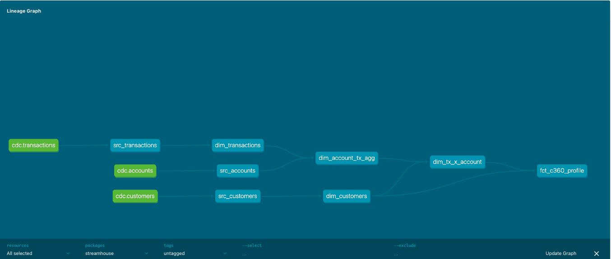

# Defining Confluent Cloud Resources with the Terraform

This section of the documentation is to present the exhaustive steps to deploy the Confluent Cloud components for Streamhouse using Terraform.

Terraform is organized under the [`IaC/`](IaC/) directory as **four independent root modules** (separate local state), each file-per-concern:

| Module | Purpose |
|--------|---------|
| `IaC/ccloud` | Core Confluent Cloud: environment, Kafka cluster, Flink compute pool, Schema Registry, service accounts + Kafka/SR/Flink API keys. |
| `IaC/AWS` | RDS PostgreSQL + the credentials secret (opt-in, has cost). |
| `IaC/connector` | Managed Debezium PostgreSQL CDC source connector (opt-in). |
| `IaC/rtce` | **Real-Time Context Engine / Lightning Query API** enablement: the Global API key + registering `fct_c360_profile` as an RTCE topic. |

This split lets the core Confluent Cloud stack run locally with **no AWS credentials**. AWS and the managed connector are opt-in cost paths. The `rtce` module is applied **last** — after `dbt` has created the different facts tables, because it registers those *existing* topics with the Lightning serving layer (see [Enable the Real-Time Context Engine](#enable-the-real-time-context-engine-rtce--lightning-query-api) below).

The figure below illustrates what the terraforms in [`IaC/ccloud/`](IaC/ccloud/) will deploy. We start from an existing Organization, with a user with Org Admin role, and Confluent Cloud Resource API Key and Secret. 



The definition helps to:
* Create environment
* Create Kafka cluster, Schema Registry, service account + Kafka/SR API key
* Flink compute pool
* Kafka topic


### Folder Structure

IaC/ccloud/ — core Confluent Cloud stack. Some important notes:

- provider.tf: requires only confluent.
- flink.tf: confluent_flink_compute_pool, no Flinks statements are those are configured via dbt.
- outputs.tf: reports important variables to be used to set the environment variables for the application.

IaC/rtce/ — Real-Time Context Engine / Lightning Query API enablement (applied after `dbt run`):

- data.tf: reads the core environment/Kafka-cluster ids from `../ccloud` state via `terraform_remote_state` (same pattern as `IaC/connector`); data sources expose the cluster `rbac_crn` and SR `resource_name` for the role bindings.
- rtce.tf: the RTCE service account, role bindings (`CloudClusterAdmin` on the cluster, `ResourceOwner` on the SR subjects), the **Global API key** (`managed_resource` kind `Global`), and `confluent_rtce_topic.fct_c360_profile` — which registers the existing topic with RTCE so the Lightning Query API serves it. Other topics are added when data engineers needs to expose new fact or dimension tables.
- outputs.tf: `rtce_lightning_api_key_id`/`_secret` used to get `CONFLUENT_GLOBAL_KEY`/`SECRET` environment variables.


## Pre-requisites

* Get the [git cli](https://git-scm.com/install/)
* Clone this repository
    ```sh
    git clone https://github.com/jbcodeforce/stream_house_c360_demo.git
    cd stream_house_c360_demo.git
    ```
* Get [Terraform cli](https://developer.hashicorp.com/terraform/tutorials/aws-get-started/install-cli)

## Get Confluent Cloud environment information

* Log to the Confluent Console
* Get your user identifier if you are an organization admin, or ask your Organization administrator for a service account that has organization admin role. User has an id starting with `u-`, while service account has: `sa-`. 

    We recommend using a service account
    
    

    Verify the role binding for this service account to have the Org Admin
    
* Get the API KEY or create new one for Cloud resource management:
    
* Start a fresh Termincal session and export those key and secret as environment variables:
    ```sh
    export CONFLUENT_CLOUD_API_KEY=PQ...
    export CONFLUENT_CLOUD_API_SECRET=cflt....
    ```
* Under `IaC/ccloud/` copy to `terraform.tfvars.example` to  `terraform.tfvars` and fill in expected values.
    ```sh
    cp terraform.tfvars.example terraform.tfvars
    ```
    Do NOT commit terraform.tfvars to version control. IT is gitignored as of now in this repo.


## Perform the deployment

* Initialize terraform state under IaC/ccloud folder:
    ```sh
    terraform init
    ```
     
* Run the plan to assess what will be created
    ```sh
    terraform plan
    ```

* Deploy the resources
    ```sh
    terraform apply
    ```

    Some resource may take some time to create.

* The result print the output content, which can always bveing retrieve using:
    ```sh
    terraform output
    ```

* Validate in the Confluent Console that the resources are created
    

* Get API Keys and Secrets in env variables
    ```sh
    ./scripts/set_env_from_tf.sh
    ```
    This writes the Confluent Cloud outputs into `apps/backend/.env`. It also reads the RTCE Global key (`CONFLUENT_GLOBAL_KEY`/`CONFLUENT_GLOBAL_SECRET`) from the `IaC/rtce` stack — those stay empty until that stack is applied (next section).

## dbt

The `dbt run` can be applied in a CI/CD process with SHA guard to avoid redeploying materialized tables that were not modified. Be sure to have set the environment variables by doing something like:

```sh
set -a
source apps/backend/.env
set. +a
```

The current lineage is presented by running:

```sh
dbt docs generate
dbt docs serve
```



The green topics are created by applications, or CDC connector.

The command below will deploy to the target environment:

```sh
dbt run --select +c360.facts.fct_c360_profile
```

This will create all the topics in the kafka cluster:


**Created topics by dbt"

## Enable the Real-Time Context Engine (RTCE / Lightning Query API)

The analytics "Customer lookup via RTCE" section queries `fct_c360_profile` through Confluent's **Lightning Query API** — a current-state point-lookup serving layer. Enabling it is a separate stack (`IaC/rtce`) because it must run **after** the table exists.

**Order of operations:**

1. `IaC/ccloud` applied (previous sections) — environment + Kafka cluster.
2. `dbt run` — creates the `fct_c360_profile` upsert/compacted topic.
3. `IaC/rtce` applied — Global key + registers the topic with RTCE.

**Prerequisites:**

* The **Real-Time Context Engine / Lightning Query API Early Access** feature must be enabled for your Confluent **organization**. Without it the Lightning API reports the org as not found (HTTP 400) regardless of this stack.
* An **OrganizationAdmin** Cloud API key for the Terraform provider (creating a service account, a Global API key, and an RTCE topic are org-level operations — a resource-scoped key returns 401). This is the same `CONFLUENT_CLOUD_API_KEY`/`SECRET` exported earlier, provided it has Org Admin.
* The `fct_c360_profile` topic already exists (step 2 done).

**Deploy:**

```sh
cd IaC/rtce
cp terraform.tfvars.example terraform.tfvars   # set prefix / cloud / region to match IaC/ccloud
terraform init
terraform apply
```

This creates a dedicated service account, grants it read on the cluster and Schema Registry, mints the **Global API key**, and registers `fct_c360_profile` with RTCE via `confluent_rtce_topic`.

**Wire the key into the backend:**

```sh
cd ../..                      # repo root
./scripts/set_env_from_tf.sh  # now picks up CONFLUENT_GLOBAL_KEY / _SECRET from IaC/rtce
```

The Lightning query is scoped by `catalog_name` = environment **id** (`FLINK_ENV_ID`) and `database_name` = Kafka cluster **id** (`KAFKA_CLUSTER_ID`) — ids, not the display names the Flink SQL Statements API uses. Restart the backend so it reloads `apps/backend/.env`, then the RTCE customer lookup will serve results.